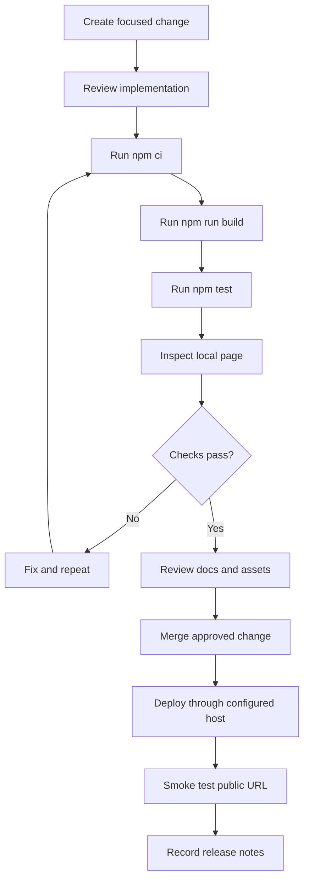

# 🚀 Release and Change Management

## 1. Release principles

A release is a reviewed, reproducible change to the static website. A successful Git commit alone does not prove that the published site is correct.

## 2. Release flow

## 3. Pre-release checklist

- [ ] Scope and acceptance criteria are clear.
- [ ] Existing assets and routes are preserved.
- [ ] Dependency changes are intentional and lockfile is updated.
- [ ] `npm ci` succeeds from the lockfile.
- [ ] `npm run build` succeeds.
- [ ] `npm test` succeeds.
- [ ] Responsive layout is checked at narrow and wide widths.
- [ ] Keyboard navigation and visible focus are checked.
- [ ] Images have appropriate alt attributes and approved usage rights.
- [ ] No secrets, private data, or local build output are committed.
- [ ] Documentation, diagrams, and changelog are updated.
- [ ] CI checks pass for the exact commit being released.
- [ ] Deployment target and rollback procedure are known.

## 4. Deployment verification

After deployment, verify:
1. Homepage returns the expected success response.
2. Stylesheet, images, favicon, and manifest load without errors.
3. The 404 page is served for an unknown route where host support exists.
4. The browser console has no new errors.
5. The page works on mobile and desktop.
6. The deployed commit matches the reviewed source revision.

## 5. Rollback

If a release breaks the site:
- Stop further promotion.
- Identify the last known-good commit or deployment.
- Restore the last known-good deployment using the hosting provider's supported procedure.
- Re-test the restored public URL.
- Record impact, cause, and corrective action in an incident report.

The hosting provider is not defined in this repository. Provider-specific deployment and rollback commands must be documented only after the actual host is selected.

## 6. Release notes

Use `CHANGELOG.md` to record user-visible changes, fixes, and breaking changes. Keep entries factual. Do not list planned work as shipped.
